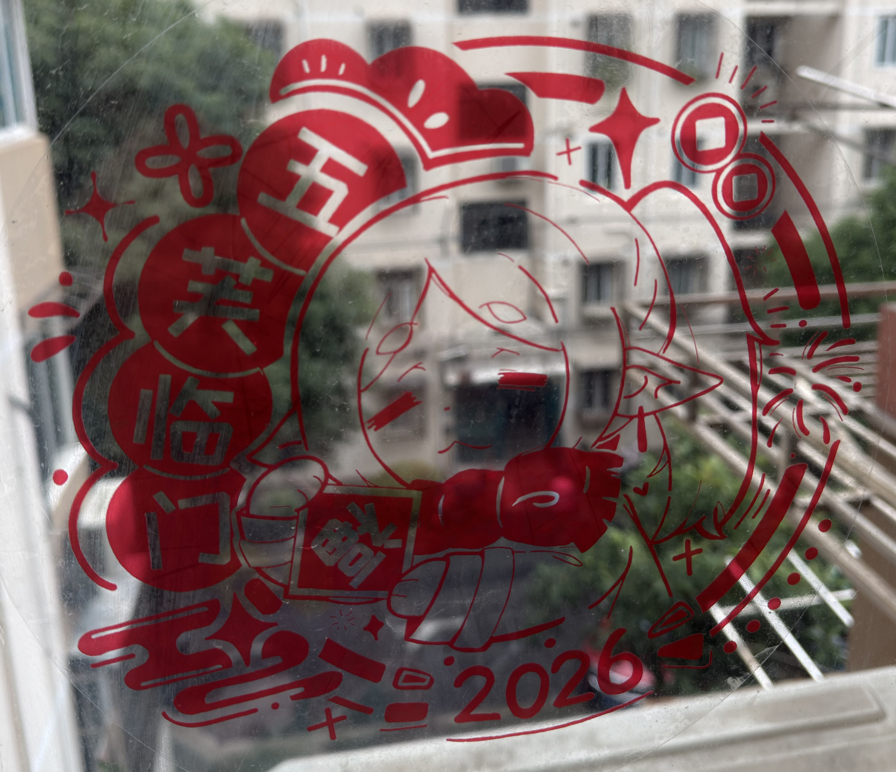

# The story behind Kirie

The inspiration for Kirie comes from **Chinese 窗花 (chuānghuā)**: paper-cut decorations placed on windows.

## A gift on the window

While thinking about a name for this project, I noticed the chuānghuā on my window.
A friend gave it to me for Chinese New Year.

*The chuānghuā on my window, given to me by a friend for Chinese New Year.*

Looking at that decoration, I thought about the relationship between a Godot scene and the web interface over it.
The paper decoration was attached to the window. What if I could put Web UI over a Godot scene in the same way?

## The words on the decoration

The decoration reads **五芙临门**, a pun on **五福临门**: “May the five blessings come to your door.”

The character **福** means “blessing.”
Here, it becomes **芙**, taken from **芙莉莲 (Frieren)**.
Both **福** and **芙** are pronounced **fú**, so the phrase keeps its sound while referring to Frieren.

The character on the decoration is Frieren from the anime [**葬送的芙莉莲 (Frieren: Beyond Journey’s End)**](https://zh.wikipedia.org/wiki/葬送的芙莉蓮).
I find it a very comforting anime.

## Web UI like chuānghuā

That became the image behind Kirie: **put Web UI onto a Godot scene like chuānghuā on a window**.

Godot runs the game and shows the scene.
The web interface sits over that scene, adding the interface that the player sees and uses.
The window decoration gave me a way to picture those two parts together.

The [introduction](./guide/introduction.md) explains how this idea works in a game.

## Choosing a name people can say

The idea came from chuānghuā, but that word can be difficult to pronounce for people unfamiliar with Chinese.
I wanted an easier name for people to use when talking about the project.

I also considered the Japanese name **senshi**.
I decided against it because it could be confused with **戦士**.

I chose **Kirie**, pronounced **ki-ri-e**, as the project name.
The choice of name followed the pronunciation concern; the inspiration came from the Chinese window decoration my friend gave me.
